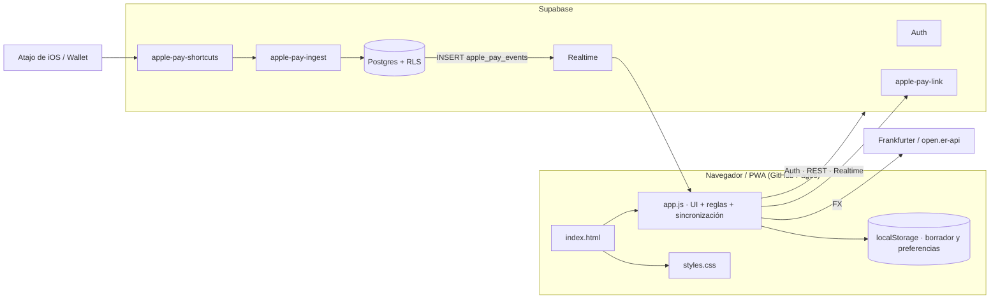

# 03 · Arquitectura

## Componentes

## Capas (de hecho, no de diseño)
No hay separación en módulos: **un solo archivo** `app.js` mezcla capas (ver deuda técnica). Pueden distinguirse por responsabilidad:
| Capa | Funciones representativas | Línea |
|---|---|---|
| Estado | `db` (objeto único), `ui` (estado de interfaz) | `app.js:158` |
| Reglas de negocio | `cardStatus`/`v102CardStatusRaw`, `monthlyTotals`, `v80Assessment`, `loanAccounting` | `app.js:342,10005,10272` |
| Persistencia local | `persist`, `migrateData`, borrador en `localStorage` | `app.js:159`, `v360SaveUI` |
| Sincronización | `f33Boot`, `f33Flush`, `v405Read`, `v405Commit`, `v10LiveStart` | `app.js:7877,7445,7642,7670,7850` |
| UI | `render`, `pages`, `nav`, funciones por pantalla | `app.js:5728,3798,498` |
| Estilos | Cascada por «versiones» con `!important` (~37.000) | `styles.css` |

## Flujo de datos de extremo a extremo
1. `f33Boot` crea el cliente Supabase y comprueba sesión (`app.js:7877-7895`); sin sesión muestra login (`app.js:7361`, `signInWithPassword`).
2. `f33LoadUser` lee el documento financiero con `v405Read` (3 consultas: revisión, `finance_items`, `finance_values`, `app.js:7642`) y lo guarda en `db`.
3. El usuario opera; `saveTx` modifica `db`, `persist` marca sucio y `f33Flush` calcula cambios y llama a la RPC `finance_apply_changes` con control optimista por revisión (`app.js:7445`, `7670`).
4. Realtime avisa de cambios de `finance_revision` y `apple_pay_events` (`app.js:7850-7870`); `v10PullRemote` decide entre lectura incremental (`v1043ReadSmart`) o completa.
5. Apple Pay: el atajo → `apple-pay-shortcuts` → `apple-pay-ingest` → `apple_pay_events` → Realtime → `v212Sync` importa como movimiento (`app.js:12876`).

## Decisiones de arquitectura observables
| Decisión | Evidencia | Consecuencia |
|---|---|---|
| Documento único en memoria, persistido como filas «clave/valor» tipadas | `docs/SUPABASE.md`, tablas `finance_*` | Simplicidad de UI; lecturas costosas (mitigadas con V1043) |
| Concurrencia optimista por revisión + fusión de 3 vías | `app.js:7670`, `v360ThreeWayMerge` (`app.js:7146`) | Evita pisar datos entre dispositivos; conflictos requieren intervención |
| Apple Pay con token por tarjeta (hash SHA-256 en BD) | `apple-pay-link`/`ingest` | Sin sesión en el iPhone; ver [07](07-seguridad.md) |
| Sin build ni framework | `index.html:35-36` | Cero cadena de herramientas; archivos de 2–4 MB |
