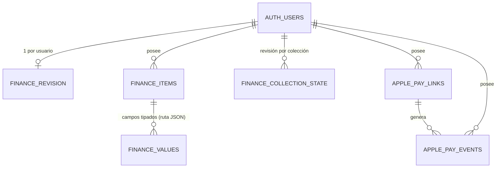

# 05 · Modelo de datos

Fuente: consulta directa al catálogo de Postgres del proyecto `<REDACTADO>` el 14-nov-2026 (no hay carpeta `supabase/` ni migraciones en el repositorio → **`[POR CONFIRMAR]` cómo se crearon**; ver deuda técnica).

## Tablas vigentes (esquema `public`)
| Tabla | Columnas clave | Filas | RLS |
|---|---|---|---|
| `finance_revision` | `user_id` (PK), `revision` bigint, `updated_at` | 2 | Sí |
| `finance_items` | PK `(user_id, collection, record_id)`, `position` int | 332 | Sí |
| `finance_values` | PK `(user_id, collection, record_id, path)`, `kind`, `text_value`, `number_value`, `boolean_value` | 10.212 | Sí |
| `finance_collection_state` | PK `(user_id, collection)`, `revision` bigint (creada en V1043) | 2 | Sí |
| `apple_pay_links` | `id`, `user_id`, `instrument_type='card'`, `instrument_id`, `card_label`, `currency`, `token_hash` único, `active`, fechas | 3 | Sí |
| `apple_pay_events` | `id`, `user_id`, `link_id`, `event_id`, `instrument_*`, `currency`, `amount>0`, `merchant`, `status` (`pending/review/imported/ignored`), `local_tx_id`, `received_at`, `transaction_time`, `imported_at` | 11 | Sí |

Las 19 tablas heredadas (`bancos`, `cuentas`, `tarjetas`, `prestamos`, `movimientos`, …) se eliminaron el 14-nov-2026 (`docs/SUPABASE.md`).

## Diagrama ER

## Modelo lógico
El documento financiero (`db`, `app.js:158`) tiene colecciones: `accounts, cards, loans, transactions, recurring, banks, budgets, budgetVersions, certificates, personalLoans, personalContacts, customCategories, settings, incomeSchedules, txRevisions, fiscalRulesVersions, automationEvents, smart360, hiddenTaxonomy, version, demo` (conteo por colección en consulta a `finance_values`). Cada registro se «aplana» en filas `finance_values` con `path` JSON-pointer (`v405Unflatten`, `app.js:7569`); las colecciones de lista guardan su orden en `finance_items.position`.

## Funciones, índices y triggers
| Objeto | Detalle |
|---|---|
| `finance_apply_changes(p_expected_revision, p_changes)` | Aplica altas/bajas, comprueba revisión (`40001`), sube revisión y registra colecciones tocadas |
| `finance_write_item(...)` | Escribe un registro solo si su contenido cambió |
| `apple_pay_remove_link(p_user_id, p_link_id)` | `SECURITY DEFINER`; sin ejecución para `anon`/`authenticated` (la llama la función edge con clave de servicio) |
| Índices | Claves primarias; `apple_pay_links_user_idx`, `apple_pay_links_user_active_idx`, `apple_pay_events_user_status_date_idx`, `apple_pay_events_inbox_idx` (el asesor los marca sin uso por pocas filas) |
| Triggers / cron | Ninguno en `public`; extensiones `pg_cron` y `pg_net` instaladas sin trabajos |
| Realtime | Publicadas: `finance_revision`, `apple_pay_events` |

## Políticas RLS
| Tabla | Política | Regla |
|---|---|---|
| `finance_items`, `finance_values`, `finance_revision` | `*_owner` (ALL, `authenticated`) | `auth.uid() = user_id` |
| `finance_collection_state` | select/insert/update propio | `user_id = auth.uid()` |
| `apple_pay_links` | `apple_pay_links_read` | SELECT propio |
| `apple_pay_events` | read / update / delete propio | `user_id = auth.uid()` |

## Datos repetidos entre vistas
- Los totales (liquidez, deuda, patrimonio) se **recalculan en cada pantalla** desde `db`, con funciones distintas por versión (`v99*`, `v186*`, `v315*`): riesgo de divergencia. `[POR CONFIRMAR]` equivalencia entre ellas.
- El detalle de movimiento existía en dos vistas (modal antiguo `v6Wallet…` y `v708`); hoy ambas convergen en `v708` (`app.js:1064`).
- Contadores como «3 cuentas» se calculan en plantillas distintas de Instituciones, Cuentas y Resumen.
