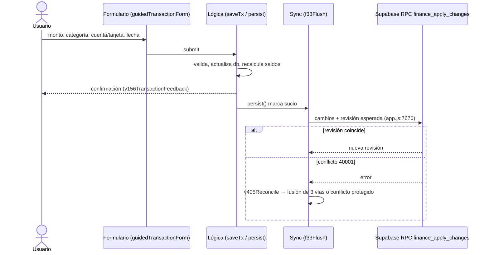
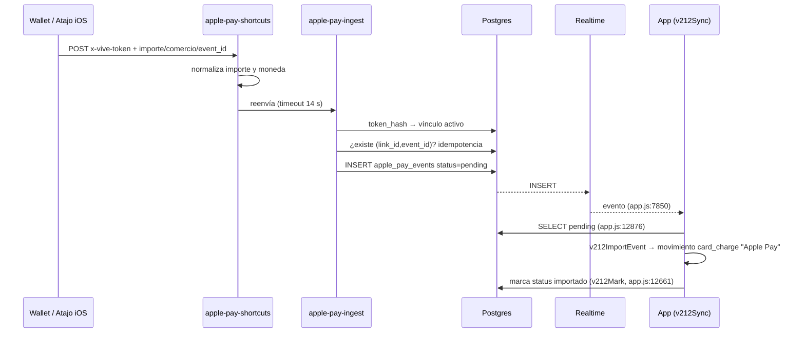
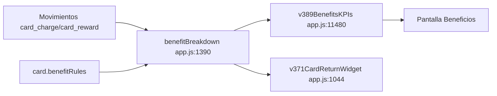

# 08 · Flujos principales

## Registro de una compra

## Sincronización de Apple Pay

Respaldo: sondeo cada 30 min con Realtime conectado, 3 min sin él (V1044).

## Cálculo de beneficios

Los beneficios son **registros manuales** («Un registro manual por tarjeta», `app.js:1605`): no hay cálculo automático desde el banco.

## Cierre de periodo
No existe un proceso de «cierre» ejecutado por servidor. El periodo es el mes seleccionado (`ui.month`) y los cortes de tarjeta se derivan por fecha: `v102CardStatusRaw` (`app.js:342`) calcula facturado, no facturado y vencido a partir de `cutDay`/`dueDay`; `monthlyTotals` (`app.js:10005`) agrega por mes; `v169UpdateOnDateChange` (`app.js:331`) refresca al cambiar la fecha; `v40ProcessDue` (`app.js:8097`) genera pagos automáticos vencidos. `[POR CONFIRMAR]` si algún paso persiste «cierres» además de `db.statements` (`app.js:1725`).
